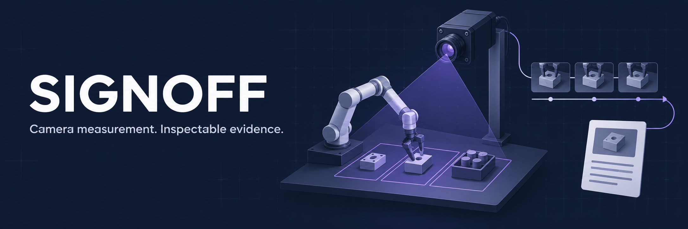
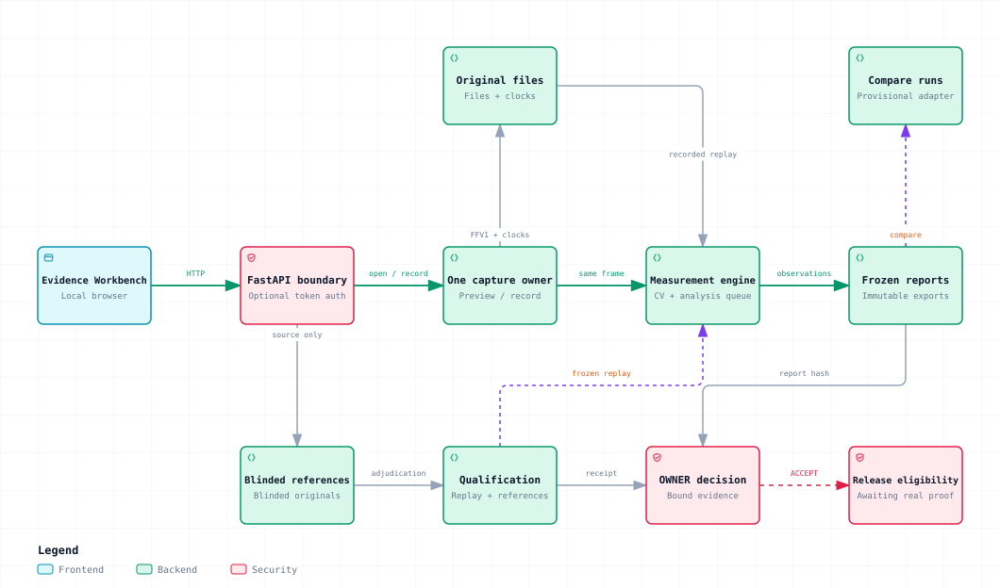

# Signoff

Signoff measures visible robot task sequences from a fixed camera and turns them
into evidence an automation engineer can inspect. The **Evidence Workbench** brings
station setup, recorded/live capture, cycle review, independent annotation and
qualification into one local GUI.

[Get started](#quick-start) · [Collect first recordings](docs/CAPTURE_GUIDE.md) ·
[System architecture](docs/ARCHITECTURE.md) · [Roadmap](docs/ROADMAP_v0.3.md)

**Current software: v0.3.0-rc.1, in maintenance.** The implemented software is on
`develop`; `main` remains the earlier scaffold. Software verification is complete
for the candidate and subsequent maintenance fixes. Real station qualification,
the two-hour camera soak and owner-pilot acceptance are still pending. See the
[current status](docs/PROJECT_STATUS.md) and [release requirements](docs/RELEASE_v0.3.0-rc.1.md).

## What Signoff helps you answer

- How many visible task cycles occurred, and how long did they take?
- Where did activity pause, become uncertain or end in a partial sequence?
- Which original observations support a reported measurement?
- How does the detector compare with separately authored references?

The reference task is **HOME → PICK → PLACE → HOME**, using a fixed camera and
marker-assisted task regions. A completed visible sequence does not establish
grasp success, product quality or robot safety. Unreviewed outcomes stay
**UNKNOWN**; detection accuracy stays **N/A** until an independently labeled
reference set is available. Signoff uses deterministic CV and rules for its
measurement path.

## The workbench workflow

| Step | What the operator does |
|---|---|
| **Set up** | Choose a camera, deliberately open preview, draw task regions and save an immutable station profile. |
| **Capture or upload** | Separately start recording, or upload MP4/MKV footage with its source declaration. Preview alone creates no recording. |
| **Analyze** | Run the shared measurement pipeline. Saved job state survives reload and matching active requests reuse the same job. |
| **Inspect and review** | Select cycles on the source-clock timeline, play viewing clips, append review notes and create a refreshed frozen report. |
| **Annotate and qualify** | Label original frames in the separate blinded reference workspace; assign dataset splits, freeze inputs and inspect scoring receipts. |
| **Export** | Download HTML, JSON, CSV or Markdown reports, or use the print view to save a PDF. |

Original media, frame clocks and hashes are preserved. Viewing clips and JPEGs are
derivatives; they do not replace the source. Human reviews are stored separately
and never overwrite detector predictions or prior frozen reports.

## Quick start

Use **Linux, Python 3.12, FFmpeg and uv**. Clone the active implementation branch:

```sh
git clone --branch develop https://github.com/santapong/signoff.git
cd signoff
uv venv venv --python 3.12
uv pip sync --python venv/bin/python --require-hashes requirements-dev.lock
```

Set `SIGNOFF_TOKEN` to a private operator token you can enter at login, then run:

```sh
: "${SIGNOFF_TOKEN:?Set your private SIGNOFF_TOKEN first}"
SIGNOFF_DATA_DIR=data/local-pilot \
  venv/bin/python -m uvicorn apps.api.main:app --host 127.0.0.1 --port 8600
```

Open **http://127.0.0.1:8600/ui/** and sign in. Start with **Stations** to configure
the task, **Capture** for deliberate camera preview/recording, or **Sessions** to
upload and review a recording. Camera access never starts from navigation or login.

Authentication is enabled by a nonempty `SIGNOFF_TOKEN`. The legacy
`SIGNOFF_REQUIRE_AUTH` variable is not currently read by the runtime; it cannot
enable authentication on its own. Use one application process per data directory.
The [architecture document](docs/ARCHITECTURE.md) explains these deployment boundaries.

For an exported source ZIP or installed wheel, set `SIGNOFF_GIT_SHA` to the exact
source commit in its candidate manifest. An unidentified installation can rehearse
the workflow, but cannot qualify the instrument. A parent Git checkout is not used
as the package's identity.

## Rehearse with generated footage

```sh
venv/bin/python tools/generate_demo.py --out data/demo-camera-v2 --lossless
venv/bin/python tools/print_markers.py --out data/markers
```

The demo writes a four-cycle marker simulation, profile and scripted reference to
an empty destination. Upload `demo.mp4` with source kind **Simulation** and the
matching profile. The generated `profile.json` contains its dimensions, marker
IDs and regions: use those values when creating the simulation station. Ordinary
analysis does not automatically load the scripted reference or populate F1.
The demo and the banner artwork are illustrative; neither is
real station qualification evidence. Synthetic live input is available only when
deliberately enabled with `SIGNOFF_ALLOW_SYNTHETIC=1` for local development.

Use the [capture guide](docs/CAPTURE_GUIDE.md) for actual station recordings. Label
original frames before viewing predictions and declare any AI assistance.
Post-analysis outcome review is not an independent reference.

## Container setup

With `SIGNOFF_TOKEN` already set:

```sh
: "${SIGNOFF_TOKEN:?Set your private SIGNOFF_TOKEN first}"
SIGNOFF_GIT_SHA=$(git rev-parse HEAD) \
  docker compose -f infra/docker-compose.yml up --build -d
```

The image uses a pinned Python base and hash-locked dependencies. Port 8600 binds
loopback and the data volume survives container restarts. Add
`-f infra/docker-compose.usb.yml` only for the selected USB device; it maps the
chosen host device to `/dev/video0` and still requires deliberate preview/recording.
Public access and TLS are separate deployment work.

## System architecture



[Explore the interactive map](docs/architecture/signoff-system.html)
(download the standalone HTML and open it locally) or read the
[full architecture](docs/ARCHITECTURE.md), including module responsibilities,
API groups, source clocks, evidence lineage, state transitions, authentication,
storage, recovery and deployment.

The core path is **camera/file → preserved observations → deterministic
measurement → frozen report**. Independent references feed qualification rather
than inference. Exact owner decisions and the read-only release gate determine
eligibility. One capture owner, a bounded analysis queue and a bounded
qualification worker coordinate the local runtime.

## Qualification and release

Freeze profiles, protocols, complete-session splits and independent reference
artifacts before tuning. Physical qualification requires at least **600 nominal
cycles**, **100 changed-condition cycles**, **100 independently labeled held-out
inactivity episodes**, an actual **two-hour source-bound soak**, and the published
accuracy, coverage/rate and latency targets. The owner reviews inactivity results
and records **ACCEPT** against the exact qualified report and receipts.

The GUI supports these assignments, freezes and decisions. For headless use:

```sh
venv/bin/python tools/qualify_dataset.py MANIFEST --data-root DATA --out data/qualification.json
venv/bin/python tools/release_gate.py --qualification data/qualification.json \
  --pilot OWNER_RECEIPT --report FROZEN_REPORT --manifest MANIFEST --data-root DATA
```

Exit **2 / PENDING** retains the candidate channel. A source label, simulation,
passing CI or owner-assisted software rehearsal cannot replace physical evidence.
Owner/assistant collaboration is an **OWNER** pilot, distinct from external validation.

Build identified source/wheel candidates from a clean committed checkout with
`venv/bin/python tools/build_candidate.py --out dist/NEW-CANDIDATE`. The destination
must be empty and the pinned build backend must be cached for offline builds.
The builder does not merge, tag, publish or approve evidence. Follow the
[branch policy](BRANCH_POLICY.md) for promotion and tagging.

## Secondary use: compare robot-policy experiments

```sh
venv/bin/python tools/compare_experiments.py experiments.json --out data/comparison
```

The comparison manifest selects frozen reports and declares experiment,
controller, policy and protocol labels. Incompatible or tampered evidence is
rejected; missing physical qualification keeps comparisons provisional. Camera
measurement remains the priority. Robot execution and policy training are separate
from the workbench; the legacy hardware scaffolding is documented in the architecture.

## Documentation and contributing

| Read | Purpose |
|---|---|
| [Architecture](docs/ARCHITECTURE.md) | Implemented components, data flow and operating boundaries |
| [Capture guide](docs/CAPTURE_GUIDE.md) | First real recordings, independent references and owner pilot |
| [Current status](docs/PROJECT_STATUS.md) | Software evidence and outstanding physical gates |
| [Camera roadmap](docs/CAMERA_FIRST_PLAN.md) / [GUI roadmap](docs/ROADMAP_v0.3.md) | Program objectives and milestone contracts |
| [Measurement requirements](docs/REQUIREMENTS_v0.2.md) | Definitions, uncertainty and qualification targets |
| [Candidate release notes](docs/RELEASE_v0.3.0-rc.1.md) | Delivered workflow, verification scope and release conditions |
| [Contributing](CONTRIBUTING.md) / [branch policy](BRANCH_POLICY.md) | Issues, changes, tests and integration rules |

Maintenance focuses on fixes and measured optimization. Open an issue for
nontrivial changes, preserve evidence/provenance contracts and run the affected
checks. Raw footage, private datasets, credentials and model weights stay outside
Git. The local full SDD remains a placeholder; implementation claims are grounded
in source and validation artifacts.

[MIT license](LICENSE).
