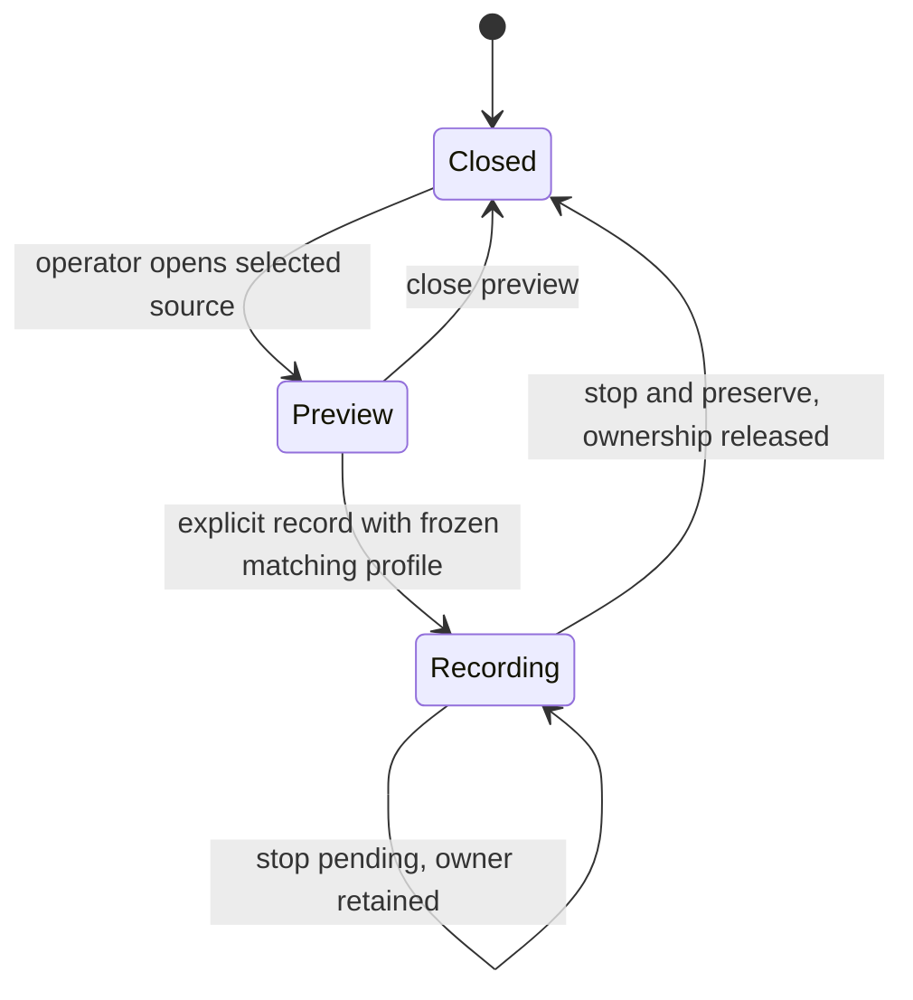

# Signoff system architecture

Source reviewed on **14 October 2026**, against `ad420c4` on `develop`.
This document describes implemented software and its boundaries. It does not
establish that a physical camera, robot station or qualification dataset has
been exercised. Production qualification remains pending; the current package
version is a software release candidate.

[Explore the system diagram](architecture/signoff-system.html) ·
[Open the SVG diagram](architecture/signoff-system.svg) ·
[Camera protocol](REQUIREMENTS_v0.2.md) · [Operator capture guide](CAPTURE_GUIDE.md)


## 1. Purpose and scope

Signoff observes a repetitive robot task through a fixed camera, measures visible
cycles and activity, and produces evidence a person can inspect. Camera
measurement is the primary product. The Evidence Workbench provides station
setup, deliberate preview/recording, session analysis, outcome review,
independent reference annotation, qualification and owner decisions.

The secondary experiment adapter compares frozen camera reports with declared
experiment, controller and policy labels. It can support Embodied AI evaluation;
it does not train policies, issue robot commands or identify a controller from
video. Robot execution and learning remain separate projects/workflows.

A completed visible sequence is not proof of a successful grasp, acceptable
product quality or machine safety. UNKNOWN is valid. The current instrument does
not calculate certified OEE, infer forces or dimensions, integrate with a PLC,
MES or proprietary robot controller, or autonomously accept an installation.
There is no LLM/VLM in its measurement path.

## 2. Runtime topology

The supported deployment is **one FastAPI/Uvicorn process per durable data root**.
That process serves the browser application and coordinates:

- One live capture owner, shared by preview, diagnostics, recording and inference.
- One offline analysis thread with at most 32 pending analysis jobs.
- One active qualification job in a lazily created one-worker executor.
- Local files for source media, profiles, jobs, revisions, reports and receipts.

The Workbench uses same-origin HTTP polling and JPEG preview; `/live/ws` is an
implemented optional event stream for WebSocket clients, not its frame transport.
OpenCV supplies
USB acquisition and deterministic visual features; PyAV decodes presentation
timestamps and writes lossless FFV1/MKV archives. FFmpeg creates derived H264
viewing clips. Jinja2, HTML, CSS and vanilla JavaScript implement the selected
navy/light/violet workbench. Acceptance math remains in Python.

The current runtime does not require PostgreSQL, Redis, a message broker, React,
a GPU or an external inference service. Directory placeholders or older stack
lists are not evidence of a deployed service.

Multiple Uvicorn workers against the same data directory are unsupported. The
analysis worker has an exclusive filesystem lock, but camera ownership,
subscriber state, reference caches and qualification coordination are
process-local. The current architecture is not a distributed execution system.

## 3. Modules and actual dependency boundaries

| Module group | Implemented responsibility |
|---|---|
| `apps/api/main.py` | Application composition/lifecycle, auth middleware, profiles, uploads, session metadata, analysis submission, run status, evidence and outcome reviews |
| `apps/api/live.py` | Camera discovery, explicit preview/record/stop routes, one capture owner and authenticated event delivery |
| `apps/api/ui.py`, `templates/`, `static/` | Operator views, region editing, playback, revision forms and qualification controls; no acceptance math |
| `apps/api/auth.py` | Shared bearer-token authority, opaque signed cookies, CSRF checks and WebSocket authentication/origin checks |
| `apps/api/evidence.py` | Blinded source frames, reference/adjudication routes, qualification workspace access and verified owner evidence bindings |
| `services/live_worker/engine.py`, `camera.py`, `soak.py` | Explicit capture lifecycle, metadata/marker readiness, deadline pacing, cumulative observations, bounded events and source-bound soak statistics |
| `services/video_worker/recorder.py` | FFV1 segments, per-frame capture clocks/pixel hashes and recording manifests; the segmented sink never opens a second camera |
| `services/analysis_worker/jobs.py` | Durable analysis queue, recovery, staged artifacts, viewing clips, immutable report publication and source/artifact verification |
| `packages/cv/signoff_cv/source.py` | Timestamped observations and strict replay from capture sidecars or decoded PTS |
| `packages/cv/signoff_cv/pipeline.py`, `task.py`, `motion.py` | Shared deterministic marker/motion measurement, finalized events, active/idle/unknown intervals and observation coverage |
| `packages/cv/signoff_cv/evaluate.py` | Separate identified-reference scoring and historical start-only evaluation; not an operational detector input |
| `packages/domain/profiles.py`, `annotations.py`, `agreement.py`, `ids.py`, `provenance.py` | Validated revisions, annotation contracts, agreement, identities and exact source-code provenance |
| `packages/domain/reference_workspace.py` | Source-only indexes/JPEG viewing, immutable cycle/inactivity references and human adjudication |
| `packages/domain/qualification_workspace.py` | Drafts, frozen input sets, approved imports, bounded evaluation jobs and saved receipts |
| `packages/metrics/signoff_metrics.py`, `packages/reporting/signoff_report.py` | Pure metric calculation, source labels, report hashes and frozen JSON/CSV/HTML/Markdown/printable exports |
| `packages/domain/comparison.py`, `tools/compare_experiments.py` | Optional comparison of intact, compatible frozen camera reports |
| `tools/annotate_reference.py`, `qualify_dataset.py`, `release_gate.py`, `pilot_backup.py`, `build_candidate.py` | Headless references, frozen scoring, read-only eligibility, staged restore and identified candidate packaging |
| `robotics/elexhub/`, `tools/run_session.py` | Separate legacy experiment rig: abstract/mock arm, scripted runner and hidden reference logger; physical serial transport is parked |

The package names do not imply a strict dependency-inversion architecture.
`ReferenceWorkspace` and `QualificationWorkspace` live under `packages/domain`
but perform filesystem/decoding/orchestration work. They reuse utilities from
`services/analysis_worker/jobs.py` and headless tools. API/UI/live/evidence routes
use deferred imports of `main.py` helpers for the data root, session paths and
jobs. Owner binding in `evidence.py` delegates receipt persistence to `ui.py`,
which can call the binding helper in return. Deferred imports avoid eager cyclic
initialization; this is explicit composition coupling, not a dependency-free
service layer.

The important enforced boundary is **observations versus references**.
`analyze_video(video, profile, clock)` receives no annotation argument. Its output
is measured before the evaluator compares it with reference labels. The blinded
workspace reads source metadata/media and reference records without loading
analysis caches or prediction-based outcome reviews.

Legacy tracking, phase-splitting/failure hypotheses and the old OpenCV GUI
annotator remain in the repository. The current Workbench pipeline does not
promote these heuristics into qualified outcomes. The headless OpenCV package
cannot operate `annotate_cli.py`'s `imshow` interface; the GUI reference editor or
headless CSV importer is the supported annotation path.

## 4. HTTP, WebSocket and operator surfaces

Paths below are application-root paths; there is no mandatory `/api` prefix.
The deployed app's `/docs` and `/openapi.json` provide detailed request contracts.

| Surface | Principal routes | Ownership/behavior |
|---|---|---|
| Status and assets | `GET /health`, `/static/*`, `/docs`, `/openapi.json`, `/redoc` | Health, public static UI assets and API documentation; health is not a physical-readiness certificate |
| Profiles | `GET/POST /profiles`, `GET /profiles/{id}?revision=…` | Create/list/read immutable normalized station revisions |
| Original sessions | `GET /sessions`, `POST /sessions/upload`, `/sessions/{sid}/experiment` | Upload MP4/MKV, preserve source hashes and append supplied experiment metadata revisions |
| Analysis and reports | `POST /sessions/{sid}/analyze`, `GET /sessions/{sid}/runs`, `/runs/{run_id}`, `/runs/{run_id}/artifacts/{name}` | HTTP 202 submission, durable status recovery and complete verified artifacts |
| Review/evidence | Under `/sessions/{sid}`: `/evidence`, `/report`, `GET/POST /review` | Original/viewing evidence, selected frozen report and separate outcome revisions |
| Camera | Under `/live`: `/cameras`, `/preview/start`, `/preview/stop`, `/start`, `/stop`, `/status`, `/preview`, `/ws` | Metadata-only discovery, explicit acquisition/recording, read-only status/JPEG and bounded authenticated events |
| Independent references | Under `/evidence/sessions/{sid}`: `/source/index`, `/source/frames/{frame}`, `/references`, `/adjudications` | Original-frame IDs/clocks, immutable cycle/inactivity labels, exports and named human adjudication |
| Qualification | Under `/evidence/qualification`: `/datasets`, `/import`, `/datasets/{id}/assignments`, `/datasets/{id}/freeze`, `/datasets/{id}/evaluate`, `/jobs/{id}`, `/receipts`, `/owner-binding` | Structured drafts, approved input freezing, HTTP 202 evaluation, verified receipts and owner bindings |
| Workbench | `/ui/`, `/ui/profiles`, `/ui/upload`, `/ui/live`, `/ui/sessions/{sid}`, `/ui/references/{sid}`, `/ui/qualification`, `/ui/login` | Server-rendered operator views; `/live/` also renders the capture view |
| Owner records | `/ui/sessions/{sid}/feedback`, `/agreement`, `/acceptance`, `/acceptance/{id}` | Append feedback, inspect agreement and preserve/download a selected OWNER decision |

Outcome correction and independent annotation are different surfaces. Outcome
review requires an observed cycle in the selected completed run. Independent
annotation marks original frames without detector suggestions and can identify
cycles or inactivity the detector missed.

## 5. Acquisition and replay

### Deliberate camera lifecycle



Camera enumeration reads process-visible `/dev/video*` and available Linux
metadata/aliases without opening a device. Discovery labels capture capability
unverified; a numeric device ID can change across reconnects. Browser preview is
a JPEG derived from this server-owned source. A browser-native webcam transport
is not implemented.

Preview opens the deliberately selected source and checks negotiated pixels,
observed rate, marker visibility and disk headroom. It creates no recording or
session. Recording reuses that owner, resolves codec prerequisites, validates
actual dimensions against the frozen profile, preflights storage and starts a
new recording-relative clock. Requested settings and observed/negotiated settings
are recorded separately. Starting recording never opens a second camera.

Each acquired observation is passed to the archive and shared measurement engine.
The engine also persists measurement events and live bus history. Counts are
cumulative; bounded recent lists are not the session denominator. Stop finalizes
the available archive and writes capture/soak state. A pending stop retains
ownership: a timeout is not permission to replace an engine that still owns its
source. The existing five-second guard remains in force.

The recorder starts only with at least **5 GiB** free space and interrupts archival
before free space falls below **1 GiB**. Five-minute segment boundaries retain one
continuous session clock. Recorder failure, changed dimensions, camera loss and
unresolved gaps preserve earlier evidence and explicit unavailable intervals;
there is no automatic evidence deletion.

### Recorded input and common inference

Upload reads bounded chunks, accepts MP4/MKV and probes actual media rather than
trusting its filename. The default upload limit is **2 GiB**, controlled by
`SIGNOFF_UPLOAD_MAX_BYTES`. An upload receives a new session and SHA-256. Source
kind and physical-capture attester are supplied metadata; attestation is not
independent proof of capture.

`VideoFileSource` uses a matching `.clock.jsonl` or legacy `frame_index.jsonl`
when present. Sidecars must cover decoded frames, have strictly ordered finite
nonnegative times and validate captured pixel hashes when supplied. Without a
sidecar, decoded presentation timestamps and time bases are used, normalized to
the first decoded PTS. Missing trustworthy timestamps or corrupt clocks fail;
there is no guessed-FPS fallback.

A finalized recording manifest identifies segment and clock hashes. Replay
checks them, feeds segments continuously through one detector and preserves
global frame identity. The detector is not reset at each segment. Uploaded files
and archived recordings therefore use the same measurement rules.

## 6. Measurement and clock semantics

The initial marker detector uses `DICT_4X4_50`, a stationary reference marker and
a tool marker, with normalized nonoverlapping HOME, PICK and PLACE regions. The
default visible cycle is stable HOME → leave HOME → PICK → PLACE → stable HOME.
HOME dwell defaults to 200 ms; region visits require 100 ms and at least two
valid observations. A visibility gap over 250 ms, a skipped region, timeout
(default 60 seconds) or incomplete EOF sequence produces partial/UNKNOWN evidence.
Persistent reference-marker displacement over 2% of the image diagonal across
five observations invalidates the profile. Resolution mismatch also invalidates
it. Settings are frozen in the profile/configuration hashes.

Motion segmentation remains a separately labeled baseline. It measures visual
activity and cannot silently acquire marker-task or grasp-success semantics.
The marker pipeline classifies stable HOME as visual idle; this is not machine
availability or a certified OEE state.

The `Frame` contract carries frame number, session-relative milliseconds, pixels,
session/segment identity, clock basis, host receipt time and quality flags.
Capture time and publication time remain separate. Live USB timing is host
receipt on a monotonic clock, not sensor exposure. Preview time is excluded when
recording resets its own origin. Replay speed does not change observed task
measurements.

Operational count/timing use finalized observed cycles. Throughput uses full
observed session duration, including inactive time. Active/idle/unknown durations
are separately accounted for. Confirmed outcome success uses only reviewed OK
and FAILED labels; UNKNOWN, unreviewed counts and denominators remain visible.
F1/timing error require an identified independent reference set. Unavailable
scores are null/N/A with a reason, not invented numeric zeros.

## 7. Evidence and integrity lineage

| Identity | Meaning and verification boundary |
|---|---|
| Source SHA-256 | Uploaded media or finalized recording manifest; manifest additionally binds every segment/clock file |
| Per-frame pixel SHA-256 | Captured decoded BGR pixels; lossless replay validates these against sidecars |
| Profile/configuration hash | Exact normalized station revision and detector configuration |
| Code SHA/environment | Measurement implementation identity and relevant runtime versions |
| Analysis hash | Deterministic observation result before run-specific viewing/export metadata |
| Artifact manifest | Hashes of published analysis, reports and derived cycle clips |
| Report hash | Canonical schema-v2 report content; separate file SHA binds the exact saved bytes |
| Reference/adjudication hashes | Original-source selections, reviewer artifacts, disagreements and named lineage |
| Freeze/qualification hashes | Exact selected sources, clocks, protocol, profiles, references and saved scoring receipt |
| OWNER receipt | Selected run/report plus manifest, qualification and explicit inactivity-review acknowledgment |

H264 clips and JPEGs are derived viewing aids. Original lossless media, frame
identity and source clocks remain authoritative for exact replay and boundary
annotation. A browser playback position multiplied by FPS is not a source frame
identity.

Artifact access checks complete state, safe member names and hashes, including
referenced source files. Verified-hash reuse is conditional on unchanged resolved
path, inode, size, mtime and ctime. Original-frame navigation also verifies index
integrity and the selected clock. Adjacent JPEGs use an eight-frame forward
window in a process-local LRU capped at 32 entries/8 MiB; keys bind source/index
identity. Decoders close per request. Cold/random late frames still decode from
the beginning, so this cache does not establish general constant-time seeking.

Hashes establish content identity and detected change. They are not signatures
from an independent capture authority, do not prove footage is physical and do
not authenticate a reviewer. The host and its filesystem remain trusted.

## 8. Jobs, publication and recovery

Analysis persists `queued` before putting its ID in the bounded queue. Active
requests with the same source hash, profile and review revision reuse the active
job; a completed rerun creates a new ID. The worker freezes session/profile/review
metadata, validates source integrity, performs inference without references,
computes metrics and writes artifacts under `artifacts.pending/`.

Only after report/clip hashes and the artifact manifest are ready does staging
become `artifacts/`, job state become `complete`, and the session's latest-run
pointer advance. A failed/interrupted job keeps its identity and prior partial
files; incomplete staging is not served as a complete report.

On restart, running analysis/capture records become `interrupted`; queued analysis
is recovered. The analysis worker acquires an exclusive process lock before
recovery. Failed initialization immediately releases that lock without relying
on garbage collection. Lock release is serialized/idempotent, and thread joins
remain outside that lock.

Qualification has separate queued/running/complete/failed/interrupted job records.
One active frozen scope is reused; a conflicting submission is refused. Restart
marks unfinished qualification interrupted rather than presenting it as complete.
Orderly close waits for started qualification work and cancels unstarted work.

The application lifespan owns cleanup of camera, analysis and previously created
qualification workspaces. Startup remains synchronous. Blocking cleanup runs off
the event loop, and every owned close is attempted on normal exit, startup failure
or application-body failure. One failure retains its original type; multiple
failures, including the original failure, remain visible together. This does not
turn an unresponsive device into a successful stop.

## 9. Durable storage and schema ownership

`SIGNOFF_DATA_DIR` is the data root. Runtime media, private evidence and generated
rehearsal data are not committed to Git.

```text
DATA_ROOT/
├── .analysis-worker.lock
├── profiles/PROFILE_ID/r000001.json
├── sessions/SESSION_ID/
│   ├── session.json
│   ├── video/source.mp4 | source.mkv
│   ├── video/recording.manifest.json
│   ├── video/recording-00000.mkv + recording-00000.clock.jsonl
│   ├── capture-profile.json / capture-status.json / live-soak.json
│   ├── live-events.jsonl / measurement-events.jsonl
│   ├── reviews/REVISION_ID.json
│   ├── experiment-revisions/REVISION_ID.json
│   ├── reference-index/SOURCE_HASH.json
│   ├── reference-revisions/REFERENCE_ID.json
│   ├── reference-adjudications/ADJUDICATION_ID.json
│   ├── acceptance/OWNER_DECISION_ID.json
│   └── latest_run.json
├── runs/RUN_ID/
│   ├── run.json
│   ├── artifacts.pending/                   # unpublished if unfinished
│   └── artifacts/                           # complete frozen outputs
│       ├── analysis.json / manifest.json / metrics.json
│       ├── report.json / report.csv / report.md / report.html
│       ├── report.print.html
│       └── cycle-000001.mp4
├── qualification/
│   ├── approved/CANDIDATE_ID/manifest.json + declared inputs
│   ├── datasets/DATASET_ID/draft.json
│   ├── datasets/DATASET_ID/draft-revisions/REVISION_ID.json
│   ├── datasets/DATASET_ID/selected-freeze.json
│   ├── datasets/DATASET_ID/freezes/FREEZE_ID/manifest.json + frozen inputs
│   ├── jobs/JOB_ID.json
│   └── receipts/RECEIPT_ID.json
└── feedback/SESSION_ID.jsonl
```

The paths are representative; uploads and live sessions use their respective
source layouts. Legacy sessions can additionally contain `analysis.json`,
`annotations/`, `.ground_truth/` or earlier report directories. Their existence
is not a new qualification receipt.

| Preserved revisions/artifacts | Mutable coordination state |
|---|---|
| Profile revisions; outcome/reference/adjudication/experiment revisions; selected owner decisions | Session capture-state metadata; latest completed-run pointer |
| Frozen qualification input sets and completed report/receipt bundles | Dataset draft and selected-freeze pointer; job state/progress |
| Finalized original segments and capture clocks | Recording manifest/logs while capture is active |
| Original-source index with verified lineage; derived hashed viewing media | Process-local queues, latest preview, hash/JPEG caches; feedback is appended |

Schema-v2 covers current profiles, sessions, analysis runs, clocks/manifests,
reports, qualification receipts, comparisons and owner decisions. The v0.3
reference/index/adjudication/dataset/qualification-job, runtime capture-profile
and soak contracts use schema 3. Readers preserve supported legacy artifacts;
older records with missing provenance are not silently relabeled qualified.

Atomic writes and exclusive immutable publication protect individual files.
Publishing several artifacts and pointers is not a cross-file ACID transaction.
Backups verify declared files; consistent backups still require a suitable quiet
or externally consistent input state. Some derived indexes bind resolved source
paths, so a relocated byte-identical restore is not itself proof that the restored
Workbench workflow has been exercised.

## 10. References, qualification and owner acceptance

The reference editor indexes original observations, steps actual frame IDs and
stores human-authored cycle/inactivity intervals. It never retrieves predictions
or prefills model outcomes. Reviewer identity, `human`/`ai_assisted` kind and
independent-labeling attestation are explicit. Boundaries resolve through original
clocks; revisions preserve history. Human adjudication links corresponding
reviewer artifacts, their disagreements and a named reason.

The headless CSV path provides the same separation using
`cycle,start_frame,end_frame,outcome,failure_type`; blank outcomes remain UNKNOWN.
The old `.ground_truth` logger supports legacy experiment evaluation, not an
operational inference dependency.

Qualification freezes the selected media/segments/clocks, profiles, protocol,
references, independent reviewer artifacts and adjudication. The evaluator
reruns inference on frozen originals/profile first, then scores against the
references. Existing report numbers are not fed back into inference. Cycle scores
use deterministic one-to-one two-boundary matching; the historical start-only
score remains separately labeled.

Ordinary session analysis does not load the reference workspace to populate its
accuracy card. Reference-based scores live in qualification/evaluation results;
saving outcome reviews or an owner decision does not rewrite the existing report
or turn those reviews into ground truth.

Full qualification additionally checks independent inactivity scoring and an
actual source-bound live soak. Inactivity scores are descriptive: no new numeric
inactivity pass threshold is invented. The OWNER must acknowledge the exact saved
inactivity review hash. Cycle qualification and full physical qualification are
shown separately so good cycle scores cannot hide missing soak/reference evidence.

Published station/profile targets remain:

| Gate | Existing required evidence/target |
|---|---|
| Nominal split | 10 sessions, ≥60 visible cycles each: 6 development / 2 validation / 2 untouched test; ≥360/120/120 cycles, frozen before tuning |
| Changed conditions | ≥100 additional cycles; conditions and unsupported cases remain separately visible |
| Cycle measurement | Precision, recall and F1 each ≥95%; absolute count error ≤2% per held-out nominal session |
| Timing | P95 absolute start/end error ≤250 ms; P95 duration error ≤500 ms |
| Observations | Usable coverage ≥95%; usable rate ≥10 observations/s |
| Inactivity | ≥100 independently annotated held-out episodes, source-bound scoring and OWNER review |
| Live soak | Actual two-hour physical recording; host-ingest-to-publication P95 ≤1 s and existing 5 s latency bound, matching source counts/hashes and measurement scope |
| Integrity/review | Original source/frame lineage, preserved independent annotations, declared assistance, named human adjudication and inspectable exact receipts |

An owner decision records ACCEPT/HOLD/REJECT, reviewer and reason. A qualified
binding checks the selected report file/content hash, manifest, qualification
receipt, measurement scope and explicit inactivity acknowledgment. A workflow-only
OWNER decision does not satisfy production qualification. OWNER plus assistant
is not external independent validation.

`tools/release_gate.py` is a read-only eligibility check. Missing/mismatched
physical, reference, scope, soak or owner evidence returns PENDING with blockers;
the CLI uses exit 2. READY means the selected evidence passes the check, not that
software has been merged, tagged or deployed. Repository release review and
production tags on `main` remain separate actions.

## 11. Authentication and trust boundaries

Runtime authentication is enabled by **`SIGNOFF_TOKEN` being set**. Bearer clients
present that shared token. Browser login creates an opaque HMAC-signed nonce
cookie with HttpOnly/SameSite controls rather than storing the raw token in it.
Cookie-authenticated mutations require the CSRF cookie/header pair; bearer clients
use their explicit authority. The login cookie's browser lifetime is configured,
but it is not a separate per-reviewer account/session database.

WebSocket routes authenticate before accepting and compare an Origin header, when
present, with the request host. Subscriber queues are bounded: recent event
history is 500 entries, at most 100 subscribers, and each WebSocket buffers at most
128 events. A dropped subscriber event becomes an explicit gap; persistent evidence
and cumulative status remain authoritative.

Health, login, API documentation and static assets are public. Other HTTP and
WebSocket access requires the configured token/cookie. **`SIGNOFF_REQUIRE_AUTH`
is currently present in deployment configuration but not consulted by runtime
code; setting it alone does not enable enforcement.** Compose protects its normal
recipe by requiring `SIGNOFF_TOKEN` during interpolation. An unset token outside
that recipe leaves development access open. The app does not provide built-in
TLS termination, roles, per-reviewer identity verification or multitenancy.

Inputs are constrained through safe identifiers, normalized region/profile
validation, finite source boundaries and source-root/member checks. Hash-verified
artifacts, originals and reference frames fail closed on changed evidence.
Reviewer names, assistance kinds and physical-source attestations remain operator
claims; the software preserves/checks their lineage, not their independent identity
or truth.

Qualification import reads approved candidates under `SIGNOFF_QUALIFICATION_ROOT`
(or the local `qualification/approved` root). It validates and copies declared
inputs into a frozen workspace. It does not accept arbitrary client filesystem
paths. CSV/HTML exports preserve their escaping boundaries.

Backup restore manually extracts only regular manifest-declared members into a
staging directory. Traversal, links, duplicates, undeclared/special members, hash
mismatches and nonempty targets are rejected. The manifest is bounded to 16 MiB;
default restored payload limit is 100 GiB, configurable with
`SIGNOFF_RESTORE_MAX_BYTES`. Successful byte verification precedes target
publication; existing evidence is not silently overwritten.

## 12. Local/container deployment and provenance

Local operation uses the locked Python environment and a loopback Uvicorn server.
The image uses a pinned Python 3.12 slim base, hash-locked dependencies and FFmpeg.
It runs one Uvicorn process on container port 8600. Compose publishes that port on
host `127.0.0.1`, mounts a persistent `signoff-data` volume and requires a token.
It has no default camera device mapping. `docker-compose.usb.yml` is a separate
explicit opt-in mapping for the chosen device; discovery sees only device nodes
exposed to the process. Exposing a device does not start capture.

`SIGNOFF_ALLOW_SYNTHETIC=1` enables explicit development input. Synthetic sessions
are labeled simulation and cannot become physical evidence. Source metadata or a
readiness panel never certifies a station.

A checkout derives code identity only from its own repository root. ZIP/wheel/
container operation uses a valid full `SIGNOFF_GIT_SHA`; missing identity remains
unknown rather than borrowing an enclosing repository's SHA. Candidate packaging
requires a committed clean source tree, records commit/tree/artifact hashes and
preserves earlier candidate outputs. A squash-merged integration SHA must not be
substituted into an already built artifact or frozen report.

The filesystem is the persistence boundary. A network filesystem, multiple
application replicas, remote camera transport or a production internet exposure
would require separate operational/qualification design, not just a worker-count
or URL change.

## 13. Optional robotics and research lane

`robotics/elexhub/` defines an abstract arm, a deterministic mock, reference
trajectories and a hidden ground-truth logger. `SerialArm` refuses unknown hardware
profiles and still raises `NotImplementedError` for actual serial operations;
physical transport/commissioning is parked. `tools/run_session.py` is a separate
legacy collection CLI with mock/none modes and its own recorder, not the
Workbench capture owner's execution path. These modules are packaged but are not
robot-control routes in the application. Mock safety hooks are not evidence of a
commissioned or safe physical arm.

The M7 comparison adapter reads intact schema-v2 reports and supplied experiment
metadata. It requires a declared fixed protocol, rejects duplicate report
identities and incompatible known profile/configuration/code/timing provenance,
and preserves unavailable scores. Missing provenance or the report's required
physical-qualification context keeps comparisons provisional. Its comparison
status is not a substitute for the full production release gate. It produces JSON/CSV/Markdown; it does not infer a policy
winner, execute robots or replace the camera qualification protocol. Task-condition
changes can confound a comparison even when instrument provenance matches.

## 14. Verification and remaining limitations

CI installs locked dependencies and FFmpeg, runs Ruff, pytest and compile checks.
The existing tests cover source/VFR clocks, recorder replay, marker/motion
finalization, cumulative live counts, reference isolation, unavailable metrics,
artifact/source tampering, auth/CSRF/WebSocket routes, job recovery, original-frame
navigation, qualification lineage, release-gate rejection, safe restore and
exceptional worker cleanup. Generated fixtures exercise software contracts; they
are not physical accuracy or independent pilot evidence. Overlapping local test
subsets must not be added into an invented unique total.

Maintenance evidence is preserved in
[the generated-source benchmark](validation/2026-10-14/reference-maintenance.json).
For the same 3,600-frame, 160×120 FFV1 fixture and original JPEG output, three
adjacent late-frame requests decoded 10,776 frames before and 3,598 after; median
sequence time was 9.27 s versus 2.76 s across five repeats. This does not establish
performance at the actual camera's dimensions or arbitrary random positions.

Known current limits are one local camera/task/profile scope, marker visibility
and fixed-view requirements, host-receipt timing, cold/large-file decode/index
cost, in-memory offline result/index growth, trusted local file/operator authority,
shared-token access and no distributed coordination. The upload interface accepts
one video rather than a companion-clock/recording-bundle transport. Source path
bindings and original evidence must be considered when relocating data. Physical
USB screening, the complete station dataset, actual two-hour soak, qualified OWNER
acceptance and production release are not established by source code, CI or the
simulation browser checks.

[Project status](PROJECT_STATUS.md) and [release notes](RELEASE_v0.3.0-rc.1.md)
track evidence and remaining gates. [The v0.3 roadmap](ROADMAP_v0.3.md) is planning
context, not proof of completed physical work. `docs/SDD.md` is a placeholder for
an owner-held document; this architecture does not invent its missing contents.
