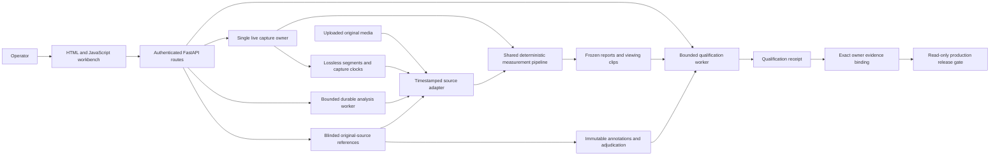

# Signoff runtime architecture

Checked against the Evidence Workbench implementation on 14 October 2026.
Maintenance is tracked in [issue #5](https://github.com/santapong/signoff/issues/5):
fix demonstrable defects and reduce measured overhead without adding product
features or changing measurement/qualification contracts.

## Process and module boundaries

Signoff runs one FastAPI process per data directory. It serves a server-rendered
HTML/JavaScript workbench, owns one live camera engine, runs one bounded analysis
worker and creates a one-worker qualification executor when requested. Deployment
with multiple Uvicorn workers against the same directory is unsupported: the
analysis worker takes an exclusive filesystem lock, while camera ownership and
other coordination remain process-local. Scaling this boundary requires a new
design and is outside the current maintenance scope.

| Module | Responsibility |
|---|---|
| `apps/api/main.py` | Application composition, authentication middleware, profile/session/run routes, data-directory access and analysis lifecycle |
| `apps/api/live.py` | Explicit preview/record/stop commands, exclusive camera-engine ownership and live events |
| `apps/api/ui.py`, `templates/`, `static/` | Operator views and interactions; they display preserved evidence and do not implement acceptance math |
| `apps/api/evidence.py` | Blinded source/reference routes, qualification workspace access and verified owner bindings |
| `services/live_worker/` | Camera adapters, bounded events, preview/recording engine and actual-observation soak samples |
| `services/video_worker/recorder.py` | Lossless archive segments, source clocks and source manifests |
| `services/analysis_worker/jobs.py` | Persistent jobs, queue/recovery, immutable artifact publication and evidence verification |
| `packages/cv/signoff_cv/` | Strict timestamped source decoding and deterministic shared task/motion measurement |
| `packages/domain/` | Profiles, references, qualifications, comparison contracts and source identity |
| `packages/metrics/`, `packages/reporting/` | Evidence-linked metrics and frozen exports |
| `tools/` | Headless annotation/qualification/comparison, backup and nonpublishing candidate/release checks |

The API currently coordinates access through helpers in `main.py`; routes defer
imports where necessary to avoid eager cyclic initialization. Domain/workers have
their own evidence contracts. Moving every route into new services would add
unverified behavior without resolving a measured bottleneck, so this maintenance
pass preserves those public interfaces.

## Evidence flows

Live preview does not create a session or archive. Recording deliberately reuses
the acquired source, resets its recording clock and freezes the actual profile
and negotiated capture configuration. Stop preserves the recording and releases
the owner when shutdown finishes. Failure or missing observations remain explicit
in the archive and session state.

Uploaded and archived sources feed the same deterministic measurement pipeline.
Inference receives observations and the frozen profile; independent annotations
never enter the detector. Human outcome reviews are stored separately and read
when creating a new report. A review does not change a prior prediction or frozen
report. A complete run publishes staged artifacts, a hash manifest and its latest
run pointer; incomplete staging is never served as complete evidence.

The reference workspace reads original media and authoritative frame clocks,
without requesting predictions. Derived JPEGs are viewing aids. Source identity,
clock selection and frame identity must still be verified when using a cache.
Any optimization must fail closed for modified evidence or stale selections.

Adjacent navigation uses a process-local JPEG LRU with an eight-real-frame
forward window, capped at 32 entries and 8 MiB. Cache keys bind the session root,
source and exact index/provenance identity. Hits and misses recheck evidence before
returning a derivative; decoding closes at the end of the request. No decoder or
image array is kept alive in the cache. First/random late-frame requests still
decode from the source beginning; this is an adjacent-navigation optimization,
not a general random-access or large-recording indexing solution.

Qualification freezes source/profile/protocol/reference/adjudication inputs and
scores that preserved scope. Actual inactivity and source-bound soak evidence are
additional requirements. The owner's decision binds exact saved report and
receipt hashes. The release gate reports eligibility; it does not merge, tag,
deploy or fabricate acceptance.

## Persistence and lifecycle

`SIGNOFF_DATA_DIR` is the durable data root: `profiles/`, `sessions/`, `runs/` and
`qualification/`. Raw media and all private runtime evidence stay outside Git.
Approved qualification imports are restricted to the configured local root.
Source artifacts, annotation revisions, freezes and complete reports retain
their identity across software updates; software maintenance never rewrites them.

An analysis job persists its state before entering a queue of at most 32 pending
items. Restart marks formerly running analysis/capture work interrupted and
recovers queued jobs. Qualification permits one active submitted job; its saved
unfinished state is marked interrupted after restart. The application lifecycle
owns starting/stopping workers and closes only workspaces that were created.
Startup remains synchronous; structured lifecycle cleanup runs blocking closes
off the event loop and attempts camera, analysis and qualification cleanup even
when startup, the application body or another close fails. A single exception
keeps its original type; multiple failures are preserved together. Failed analysis
recovery releases its process lock immediately, and repeated lock release is
serialized and idempotent.
Camera stop retains its five-second guard; a worker still owning hardware must
not be replaced merely because a caller timed out.

Atomic JSON writes and immutable publication protect local evidence, with source
and artifact hashes checked at their trust boundaries. The runtime is a local
measurement application, not a distributed database or an exactly-once external
execution service.

## Maintenance verification

Use the existing locked environment. Test the changed integrity/lifecycle paths
and unchanged public response fields; run the normal CI suite for integration.
Performance comparisons use the same declared generated source, clocks and
selected frames before/after, with identical returned evidence. Record wall time,
work avoided and limitations separately. Simulation performance is not physical
camera accuracy, real two-hour-soak evidence or owner-pilot acceptance.

The [generated-source benchmark](validation/2026-10-14/reference-maintenance.json)
compared the same 3,600-frame FFV1 source and original JPEG output across five
repeats. Three adjacent late-frame requests decoded 10,776 frames before and
3,598 after; median sequence time was 9.27 s before and 2.76 s after. This host's
160×120 simulation does not establish performance at real camera dimensions.

Production remains pending the real station qualification and approved release
flow described in [the release notes](RELEASE_v0.3.0-rc.1.md).
